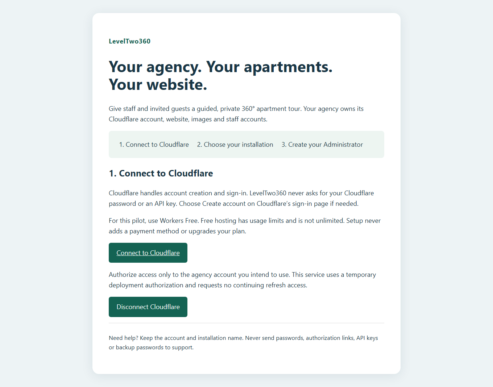
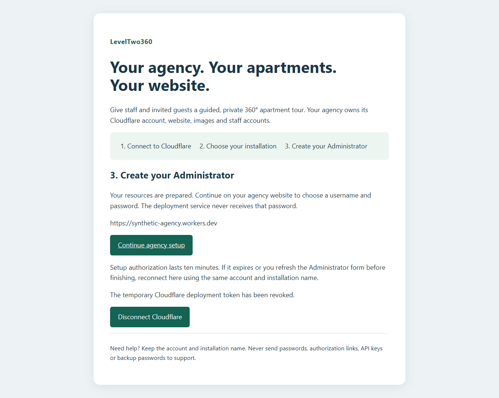
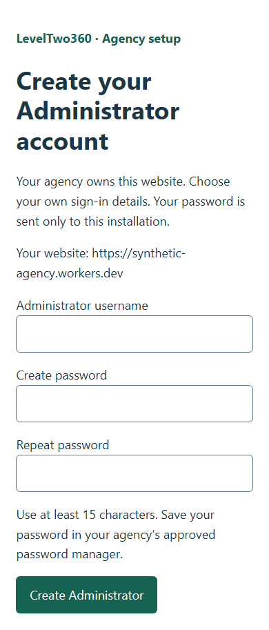
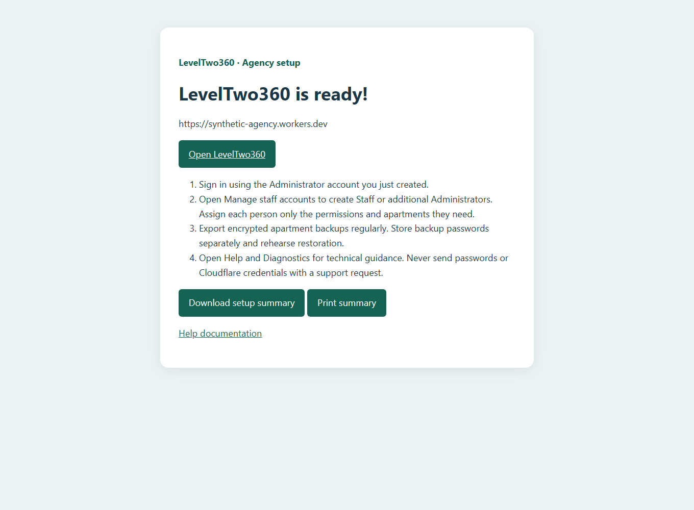

# LevelTwo360 agency setup — development preview

Phase 1 is **not release-ready**. The browser workflow is implemented and locally rehearsed. The public OAuth client, hosting approval, verified live Free-plan response, independent Cloudflare acceptance and complete update integration remain open. Do not send a live deployment invitation yet. Phase 2 has not started.

## For an agency

Your agency controls its own Cloudflare account and LevelTwo360 website. Each installation has its own Worker, D1 database, private KV image store, SQLite Durable Objects, guest secret and staff accounts. The developer does not receive a standing application account. Cloudflare hosting authorization and LevelTwo360 sign-in are separate.

When the owner has released this service, the invitation will contain one **Deploy LevelTwo360** link to the approved HTTPS setup website. No software installation, terminal, SQL, copied API key or agency GitHub account is needed in the companion workflow.

1. Select **Connect to Cloudflare**. Create an account on Cloudflare if necessary, or sign in there. LevelTwo360 never asks for your Cloudflare password. Review the consent page and authorize only your agency account.
2. Choose the agency account and a recognizable installation name. Keep the same name when retrying. Check **Workers Free** in Cloudflare and confirm it in the wizard. The service also requires verified read-only plan evidence before provisioning. A Free website/zone plan is different from Workers Free.
3. Select **Deploy LevelTwo360** once. The wizard prepares separate resources and initializes the database. Refreshing the wizard checks the existing job. If authorization expires, reconnect using the same account and name.
4. Select **Continue agency setup**. This opens your agency website. Choose an Administrator username and a password of at least 15 characters. The password goes directly to this website, not through the deployment companion. Keep it in your agency-approved password manager. The authorization expires after ten minutes; reconnect to the wizard if necessary.
5. At **LevelTwo360 is ready!**, download or print the setup summary, then open LevelTwo360 and sign in. The summary includes the website, username and version; it contains no password, setup ticket or deployment secret.
6. Open **Manage staff accounts**. Create individual Staff and additional Administrator accounts, assign existing permissions and apartment scope, and share initial credentials through the agency’s approved channel. Administrators can disable/reset accounts, manage apartments and guest invitations, use Diagnostics, and export encrypted apartment backups through the existing tools.

Use synthetic apartments while checking uploads, editing, publication, guest restrictions and backup restoration. Approve real content separately. Export encrypted backups regularly and keep their passwords separately. Apartment exports do not replace an infrastructure backup of staff accounts and configuration; see [BACKUPS.md](BACKUPS.md) and [DISTRIBUTION.md](DISTRIBUTION.md).

## Free usage is limited

Official limits checked on 18 November 2026:

| Resource | Workers Free allowance relevant to this application |
| --- | --- |
| Workers | 100,000 requests/day; 10 ms CPU per request; 128 MB memory |
| D1 | 5 million rows read/day; 100,000 rows written/day; 5 GB total storage; 10 databases |
| KV | 100,000 reads/day; 1,000 writes, deletes and lists/day each; 1 GB storage |
| SQLite Durable Objects | 100,000 requests/day; 13,000 GB-seconds/day; separate storage limits |

These allowances are shared with other workloads on the account. Exhaustion can stop service. The intended pilot needs no paid plan; this is not an unlimited-free-service promise. Setup does not add a payment method, change a subscription or activate paid products. It uses only Workers, D1, KV and SQLite Durable Objects. See current [Workers limits](https://developers.cloudflare.com/workers/platform/limits/), [D1 pricing](https://developers.cloudflare.com/d1/platform/pricing/), [KV pricing](https://developers.cloudflare.com/kv/platform/pricing/), and [Durable Object pricing](https://developers.cloudflare.com/durable-objects/platform/pricing/).

## Recovery

| What happened | What to do |
| --- | --- |
| Refreshed/interrupted wizard | Refresh to check the job. Reconnect if needed, select the same account and installation name, then retry. |
| Cloudflare denied/expired authorization | Reconnect on Cloudflare. The existing deployment journal is retained. Never send a password or API key to support. |
| Free plan cannot be verified | Stop before provisioning. Check Workers Free in Cloudflare. The publisher must validate its read-only plan adapter; a checkbox alone cannot bypass it. |
| No workers.dev address | Choose the account’s free workers.dev subdomain in Cloudflare, then retry. No paid domain is required. |
| Database or deployment failed | Retry the same name. Only additive schemas are reapplied; saved resource identities are reused. No resource is deleted. |
| Administrator form refreshed/ticket expired | Return to the wizard, reconnect and choose the same name. A new pending ticket invalidates the old one. |
| Submitted twice/lost the success response | Sign in at `/staff` with the original chosen details. A retry cannot reset the first Administrator. |
| Existing installation found | Use its existing sign-in. Setup does not upgrade it, replace its accounts or assume ownership from its name. |
| Temporary token revocation could not be confirmed | Revoke the OAuth application in Cloudflare’s authorized applications. The companion discards its token and never stores refresh access. |
| Lost every Administrator credential | Follow the authorized infrastructure-operator recovery procedure in [DEPLOYMENT.md](DEPLOYMENT.md). There is no public password-reset backdoor. |

Cloudflare account-level prerequisites include verified sign-in, permission to create the required resources, an available workers.dev subdomain, capacity within account quotas, and permission to authorize the publisher’s OAuth client. Some accounts restrict public OAuth applications. Ask an authorized account owner to review restrictions; the wizard never changes them.

## Updates

Installed application/build/schema information is already available in Help/version and authenticated `/api/staff/version`. No automatic or silent update runs. Re-running initial setup is not an upgrade mechanism.

The new [update coordinator](agency/update.mjs) verifies Ed25519-signed release bytes, exact artifact SHA-256, compatible versions and additive schema declarations. It requires a current Administrator approval for the installation, source build and exact manifest, plus fresh Cloudflare authorization. It requires database, actual JPEG and configuration backup evidence with a restore check, rechecks authorization after backup, verifies deployed health, and requests code-only recovery preserving current data and secrets after failure.

This coordinator is a tested **integration component**, not a released updater. The Administrator update screen, durable approval/progress jobs, approved signing-key/release catalog, real backup/export adapters, compare-and-swap deployment adapter and Cloudflare code-recovery adapter are not yet connected. No available compatible release is advertised and no automatic whole-database rollback is offered. These are Phase 1 implementation gates, not owner approvals disguised as completed work.

Application-only operational changes continue to use existing Administrator permissions. Changing Worker code, environment, bindings, secrets or D1 schema requires separate Cloudflare infrastructure authorization even when a LevelTwo360 Administrator approved the update. Signing a future release does not grant the publisher authority to deploy it into every agency.

## Screenshots and evidence

The screenshots use a synthetic agency and localhost infrastructure adapters. They do not demonstrate a live Cloudflare account or actual Cloudflare consent page.

Publisher deployment and acceptance requirements: [agency/README.md](agency/README.md). Invitation draft: [agency/INVITATION.txt](agency/INVITATION.txt).
