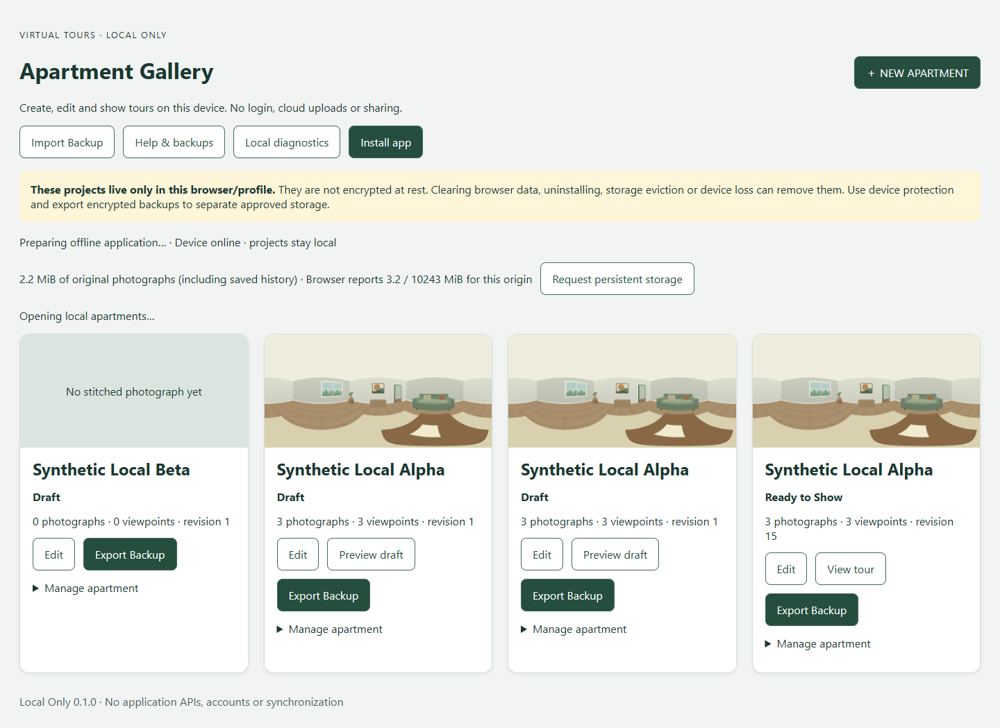
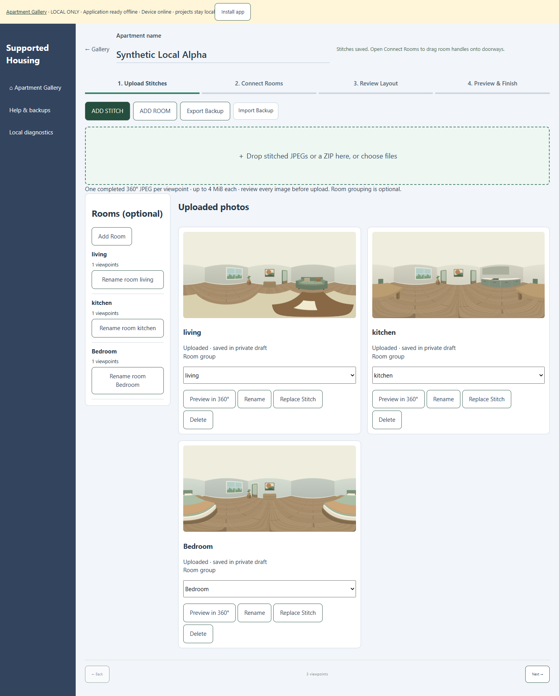
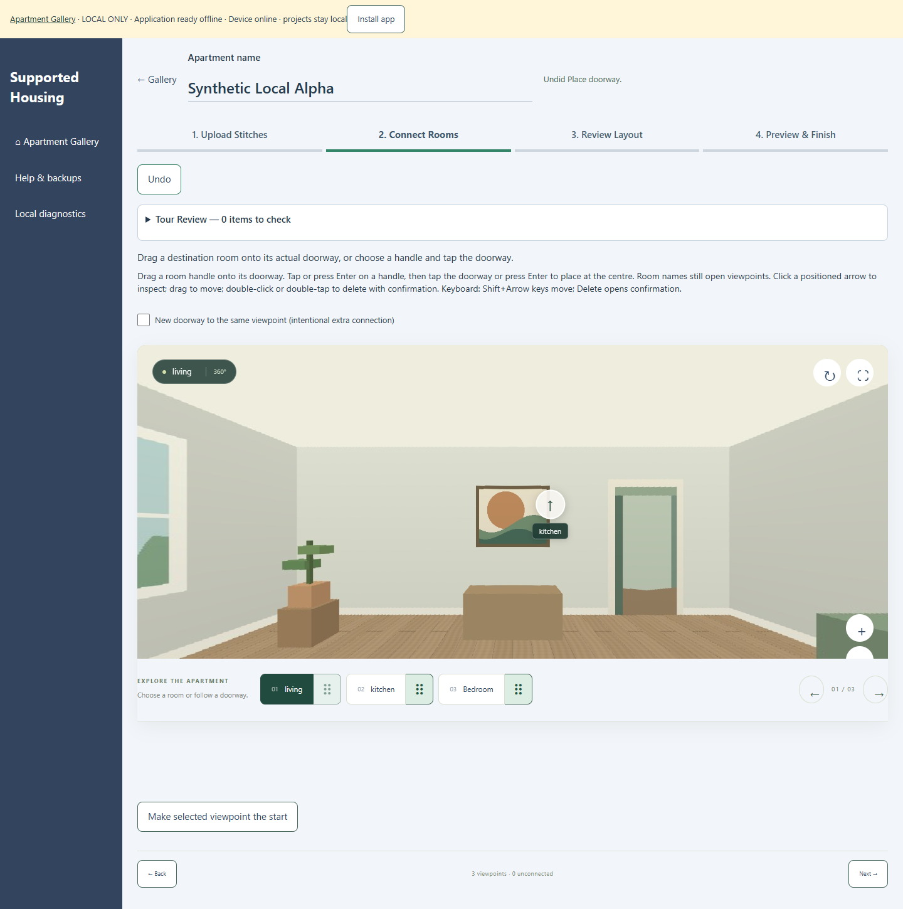
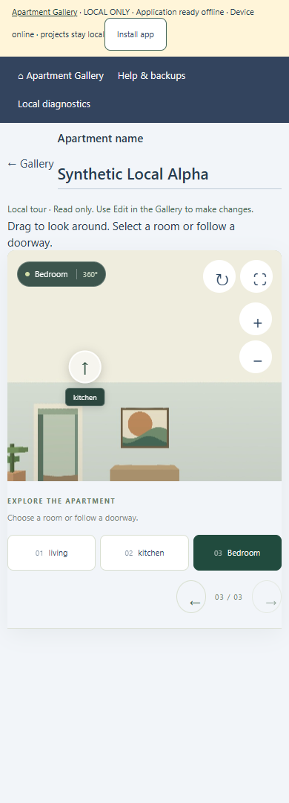
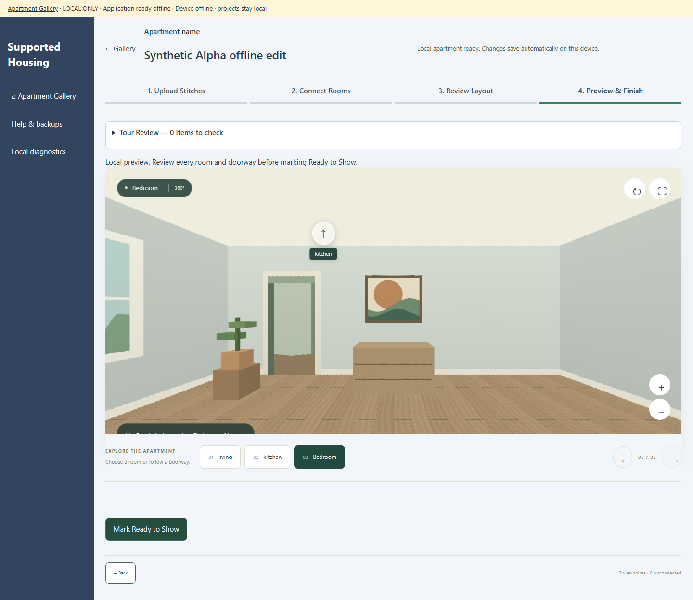
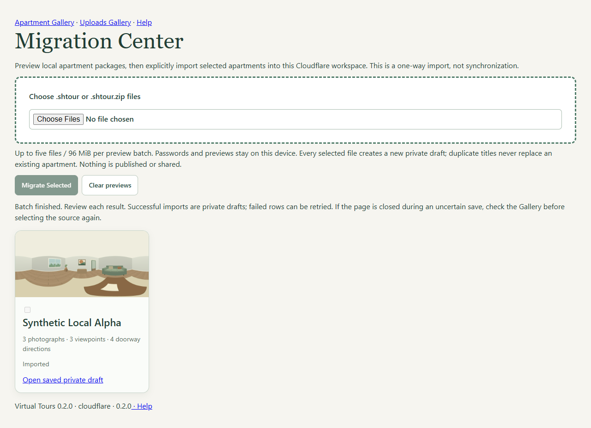

# Local Only acceptance · 17 November 2026

Scope: separate device-only edition; synthetic fixtures only. Existing Cloudflare deployment was neither contacted nor redeployed. No production D1/KV/configuration/account/invitation changes, external host creation, billing, public release or license selection.

## Verified

| Gate | Result and evidence |
| --- | --- |
| Full regression | **97/97 passed**, Node 24; baseline 87. Existing authentication/UAC/guests/offline/ZIP/encryption tests remain. Added local multi-apartment/CAS/history/quota/transaction-rollback/package-boundary/service-worker/failure-timeout tests. |
| Current editor reuse | Canonical current guided-editor source copied byte-for-byte into each edition; cloud/local runtimes implement the explicit load/save/complete adapter. Cloud prepare succeeds. No legacy-editor fork. |
| Browser editor | **PASS** JPEG + ZIP review/import, real thumbnails, blank layout, optional multiple viewpoints per room, actual mouse doorway drag, reciprocal placement, accurate saved coordinates, arrow movement/Undo, generated graph/reset/Undo and Ready state. |
| Device storage | **PASS** independent apartment IDs/revisions; original bytes; stale-save rejection in two actual windows; process restart; quota rejection and forced interrupted final transaction leave previous data intact. Deletion cancel and confirmed scoped deletion pass. |
| Encrypted backups | **PASS** complete UI export/restore with new identities; wrong password, damaged archive, duplicate approval; shared unit tests cover truncated/incomplete packages and interrupted export. Exact photo and tour preservation verified. Legacy same-origin draft is copied only explicitly; its original remains. |
| PWA | **PASS on Windows Chromium automation:** real PWA install through browser DevTools, OS app-state query, complete process close, server stopped, fresh process offline, then launch and inspect the previously installed **standalone app window** (display-mode asserted) and perform offline workflows in that window. No physical device claim. |
| Offline authoring | **PASS** Gallery and every sphere, editing/save/reload, encrypted export/import and legacy copying after restart with server stopped and browser networking disabled. Not a physical airplane-mode test. |
| Isolation | **PASS** final run observed 734 browser request events (including cache-served module loads): zero external HTTP destinations, zero non-GET requests, zero upload/API traffic, no backup password in URLs/body. Explicit external fetch blocked before network. SW runtime tests reject cross-origin, unknown and mutating requests without proxying. Project photos use Blob URLs. |
| Migration compatibility | **PASS** actual existing Migration Center frontend and Worker route code, with isolated in-memory SQLite D1/KV test adapters: local encrypted file validates before any upload, selection/confirmation required, exact tour + every JPEG byte, new private draft, no share/publication. This is not a live Cloudflare import or edge-runtime measurement. |
| Responsive viewing | **PASS** desktop, 390×844 phone, 768×1024 tablet and 900×700 unfolded-style viewport, every panorama and room selector, no horizontal overflow or page errors. Physical touch/pinch/fullscreen remains below. |
| Cloud preservation | No live calls or deployments in this milestone; Worker backend/schema/account/permission/data code unchanged. Shared frontend adapter extraction remains covered by regression and local migration UI/backend tests. A future cloud deployment will pick up a prepared v8 common-viewer cache bump; none was performed here. |

Private test exports, profile directories and request logs remain outside Git under the local test evidence directory. Only synthetic screenshots below are committed. CI runs regression, Chromium browser acceptance and the isolated Migration Center compatibility test. Final PR/Actions/main references are recorded in LOGBOOK.md after verification.

## Screenshots

## Remaining platform checks and limitations

- ADB lists no attached Android device. Physical Fold 7 and iPad acceptance is **pending**; viewport automation is not physical testing.
- Windows Chrome/Edge package instructions are provided. Android/iPad require an on-device localhost server or separately approved trusted HTTPS **static-asset installer**. No such host is automatically deployed. Physical mobile installation, Safari behavior, storage retention and OS airplane mode are unverified.
- IndexedDB project content is **not encrypted at rest**. OS/device security and password-encrypted exports are the protection model. Browser clearing/uninstall/eviction/device loss may remove projects, even after persistence permission.
- Revision history retains original replacement photos and consumes space; no automatic pruning/deletion. Backups export the chosen current snapshot, not the whole revision database. Browser quota/availability vary by device/profile.
- True disk failure/process termination at every possible write instruction is not exhaustively tested. Atomic transaction-abort and quota failures, and completed-save process restart, are verified.
- Browser-managed fixed application update checks may occur online; the app has no apartment-content transport. OS/browser/extension telemetry is outside application control.
- Manual Cloudflare migration was verified against its existing code with test storage, not the live protected pilot, which was explicitly excluded from modifications.

## Short physical checklist

1. Install from the supported secure address and wait for **Application ready offline**.
2. Import a synthetic encrypted backup; open every room/doorway; pan, pinch, zoom/fullscreen folded, landscape and unfolded.
3. Airplane mode → fully close/reopen the installed app → view all rooms; export and restore an encrypted backup.
4. Reconnect; verify projects remain. Desktop: edit/save, restart offline and confirm the edit. Mobile editing is optional and desktop-focused.

See [LOCAL-ONLY.md](LOCAL-ONLY.md) for installation, storage, recovery, backup and explicit migration instructions.
