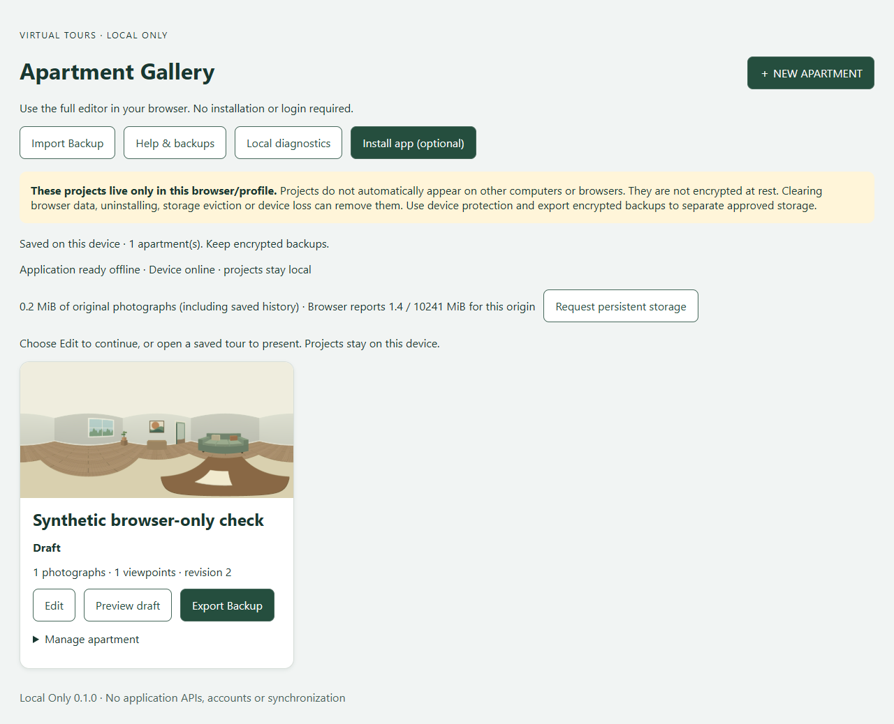
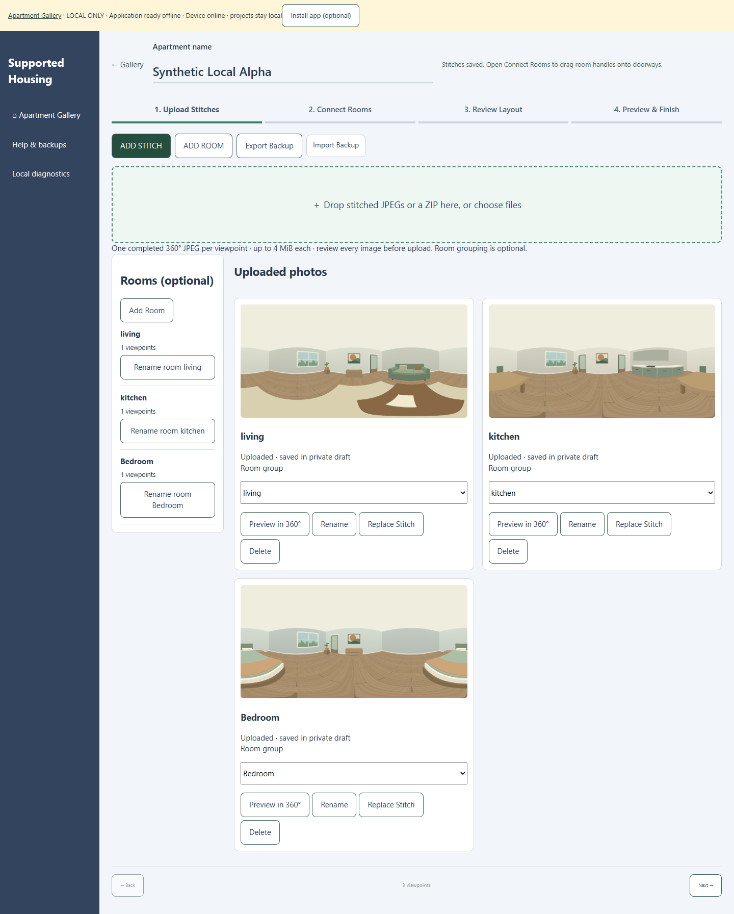
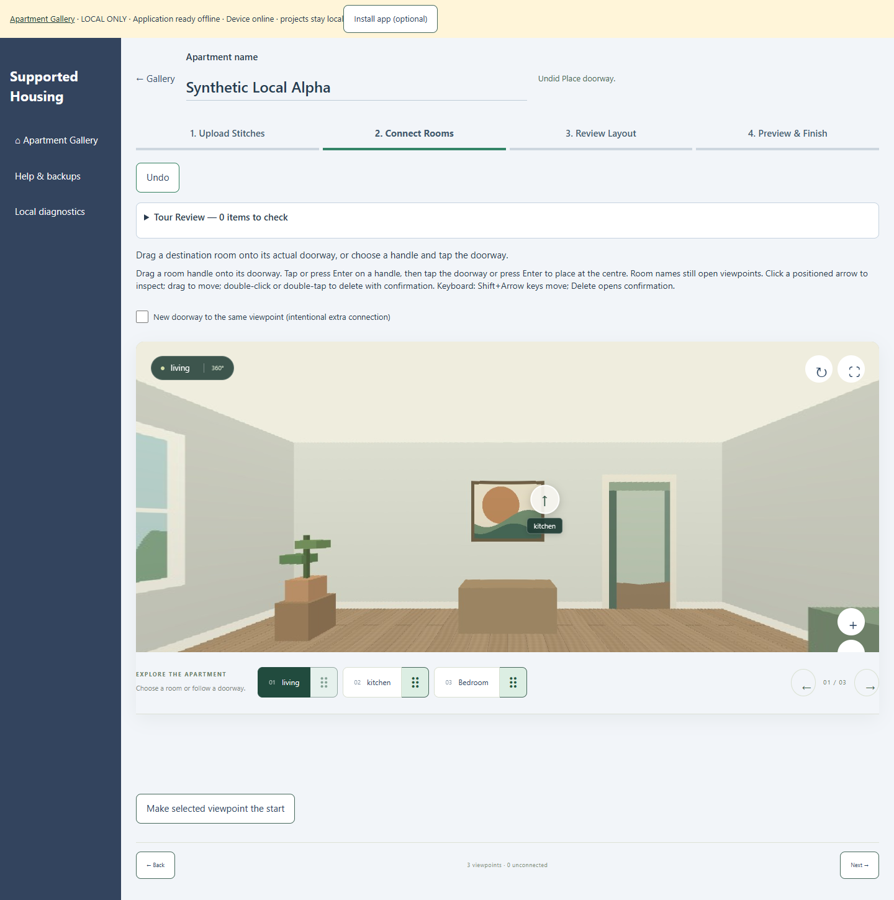
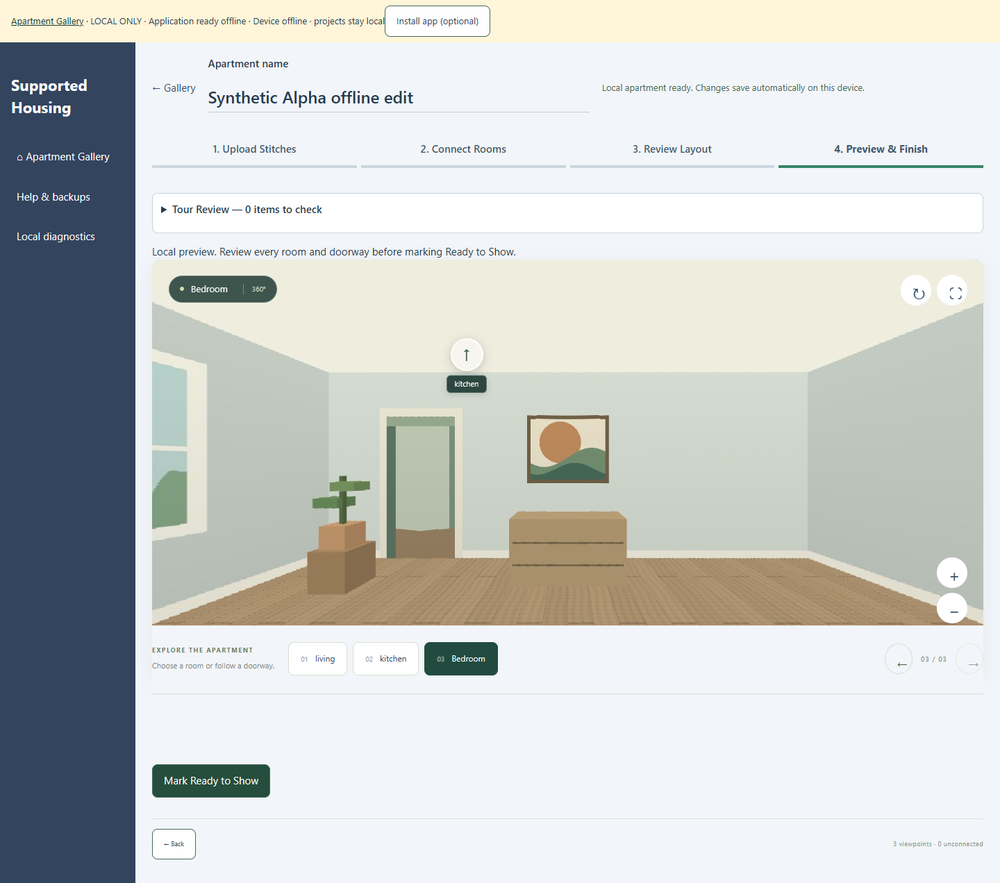

# Browser-first Local Only website

The dedicated website serves only the existing Local Only frontend. Staff open its HTTPS URL (provided in the deployment handoff/PR) and immediately use the current Gallery and four-step editor. **No installation, account, Node.js or command prompt is required.** An optional install button does not gate any feature. The existing authenticated online edition remains separate and unchanged.

## Staff workflow

1. Bookmark the exact website address in a normal browser profile. Choose **NEW APARTMENT**.
2. Import completed Stanford VFTCam 2:1 stitched JPEGs or ZIPs, review/name/group them, then connect doorways in the existing panorama editor.
3. Review layout, preview every viewpoint and mark **Ready to Show**. Nothing publishes or uploads. Wait for **Saved on this device** after edits.
4. Return to this exact address in the same browser/profile to continue or present a saved tour. Projects do not automatically appear on another device/browser.
5. Use **Export Backup**, choose/confirm a password, and keep the encrypted .shtour.zip and password separately. **Import Backup** restores a new local apartment; replacing a current editor draft still requires confirmation. Existing backup formats/security are unchanged.
6. Before disconnecting, wait for **Application ready offline**. Reopen the bookmarked address offline when your browser retains the cache. If caching is blocked or incomplete, online editing still saves locally, but offline reopening is unavailable. Reconnect/reload without clearing site data.

Projects use this origin's IndexedDB and are **not encrypted at rest by the application**. Clearing browser data, storage eviction, private browsing limitations, uninstall/browser/device loss or a changed website address can remove access. Persistence permission reduces eviction risk, not all data-loss risks. Use device protection and encrypted backups. Copying a URL does not transfer projects. Older localhost projects require explicit encrypted export/import; no automatic migration or synchronization occurs.

## Privacy boundary

- Photos, project records, layouts, edits and decrypted backups stay in the browser. Panorama reads use local Blob URLs. Apartment IDs stay in URL fragments, not HTTP request paths/query strings.
- Page CSP has `connect-src 'none'`; fetch/XHR/beacon/socket APIs are blocked. No analytics, fonts, CDNs, authentication or application APIs are loaded. The service worker may fetch only this origin's integrity-checked static shell during installation/updates; runtime serving is cache-only. Its response CSP allows same-origin asset reads without allowing the page to send content.
- Static hosting has no D1, KV, R2, Durable Object, secret or user-storage binding. No staff/guest API or dynamic backend exists. Unknown paths return 404; no SPA fallback exposes another workflow. Invocation logging/Logpush is disabled. Normal provider request metadata (IP, fixed asset URL and operational counters) is inherent in website delivery; no claim is made to suppress browser/OS/extension telemetry outside this app.
- Uploaded files are local imports, not HTTP uploads. Encrypted backup export/import and sanitized diagnostic export remain local. Original JPEG bytes, room graph and backup compatibility are unchanged.

## Actual acceptance · 17 November 2026

| Test | Result |
| --- | --- |
| Regression suite | **99 passed**: existing 97 plus isolated hosting configuration/staging/control-file checks. |
| Live Chromium, installed Chrome, installed Edge | Each passed **20 no-install browser gates**: clean visit, multiple apartments, JPEG/ZIP, room grouping, doorway drag/reciprocals/movement/Undo, layout/reset/Undo, Ready/viewer, refresh, complete browser-process restart, editing/save/reload/all spheres offline, encrypted export/restore, damaged/wrong-password handling, old-draft preservation, stale-save rejection and scoped deletion. No PWA was installed. |
| WebKit test runtime on Windows | The same **20 browser gates passed**, including offline restart. This is not physical Safari/iPad acceptance. |
| Network inspection | Zero external HTTP destinations or non-GET/upload/API calls during import, editing, save, viewing and backup operations; no backup password in traffic. Blob URL image reads are local. Exact request counts and full sanitized evidence remain in private per-browser output. |
| Hosted asset parity | All **45 shell assets** matched staged bytes. Exact `/` and `/editor/` static rewrites fixed the first live exact-path routing 404. No extra project JPEGs/backups/data were staged or deployed. |
| Free isolation | Authorized dashboard shows **Free / $0 / Current plan**. Existing OAuth can deploy the new site; subscription API is 403, so no broader permission was requested. New site has zero bindings and Logpush disabled. Existing online deployment metadata is byte-identical before/after. No billing, production deployment or data-resource changes. |
| Physical devices | ADB lists no attached Android device; physical Fold 7/iPad unavailable. Phone/tablet/unfolded viewport checks passed, but do not establish real touch, OS retention or airplane-mode acceptance. |

Online create/import/save/reload was also verified with service workers explicitly blocked: caching is optional for online local editing, and the page does not falsely claim offline readiness. API/image backend paths return 404.

The existing Local Only installed-PWA regression remains alongside a new no-install CI run. Private evidence is under the operator's LocalAppData SupportedHousingTour/local-browser directory; no browser profiles, backups, credentials or deployment identifiers enter Git.

## Safari / iPad limitations

Browser storage is not permanent. WebKit can evict IndexedDB and Cache API data under storage pressure, inactivity or overall quota limits, and persistence uses heuristics. WebKit's tracking-prevention policy also describes a seven-day Safari-use inactivity cap for script-writable storage in applicable circumstances; this is not a universal seven-calendar-day guarantee or a permanent-storage promise. Home Screen and Safari tab storage behavior can differ. See [WebKit storage policy](https://webkit.org/blog/14403/updates-to-storage-policy/) and [WebKit tracking-prevention explanation](https://webkit.org/blog/10218/full-third-party-cookie-blocking-and-more/).

Use a normal browser, return regularly, export an encrypted backup after each editing session and verify restoration. Physical Safari/iPad installation-free offline reopening, touch/fullscreen and long-term retention remain unverified. Optional installation may help some browser policies but is not required to use this website and never replaces backups.

Short physical check: open the URL → import a synthetic backup → view/pan/pinch/fullscreen and follow every doorway → wait for offline-ready → airplane mode → fully close/reopen the browser at the bookmarked URL → view/edit/save/export/restore → reconnect and confirm projects. Do not clear site data during the test.

## Maintainer deployment / recovery

`node local/build.mjs` reuses the current editor/viewer and creates only allowlisted application assets. `stageStaticSite()` in `local/hosting.mjs` copies that exact manifest plus `_headers` and `_redirects` into a **fresh empty private directory**, never a repository sweep. `staticSiteConfig()` produces a separate assets-only Workers configuration, exact HTML paths, no SPA fallback, no storage/backends/secrets/logging, and rejects the known online/probe target names. Keep the account-specific configuration and deployment receipts outside Git. Inspect the existing account/plan and name availability before creating or updating the isolated target; never use the online pilot configuration.

Cloudflare's [static-assets pricing](https://developers.cloudflare.com/workers/static-assets/billing-and-limitations/) states that static asset requests are free/unlimited; Free file limits apply. This small bundled shell uses 46 served static files including its asset inventory, well below published limits. No paid plan/resource was enabled. Preserve this website's hostname: moving origins requires explicit local backup transfer. To roll back an asset update, deploy a previously verified shell to this same isolated target; do not clear local projects or touch the online edition. The optional desktop package/server and existing cloud migration workflow remain available.
