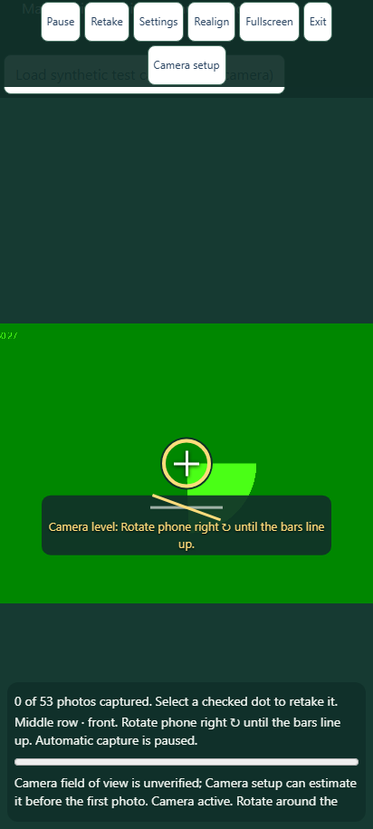
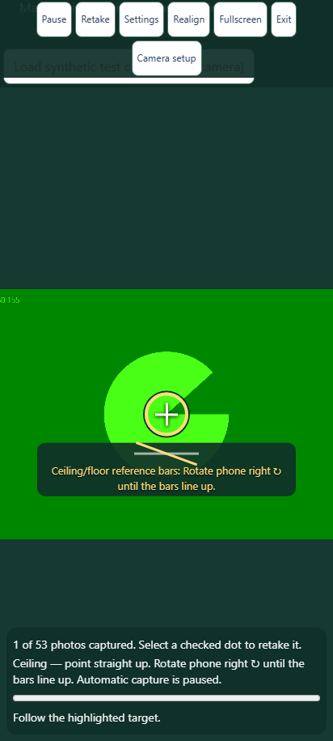
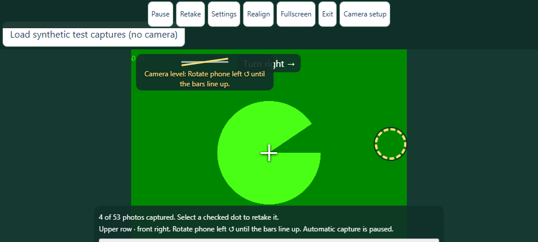
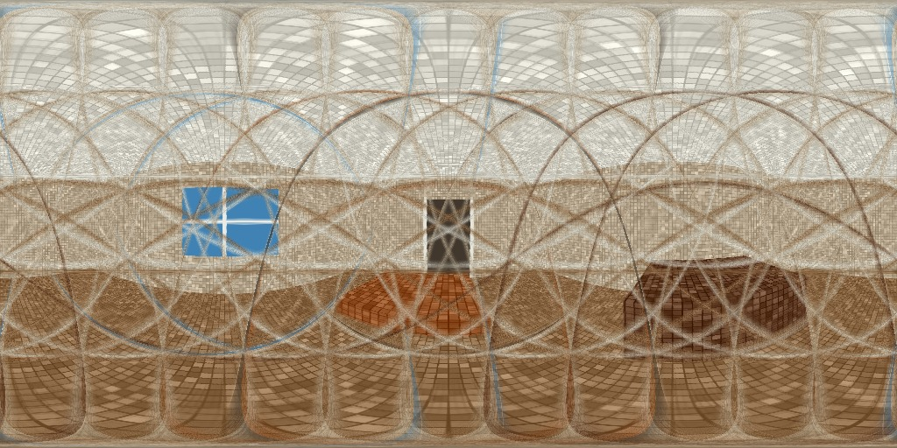
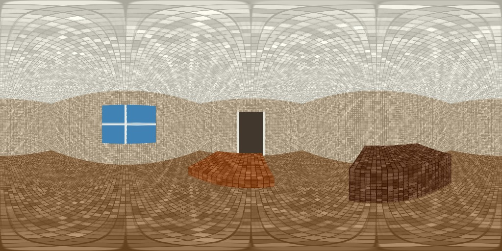
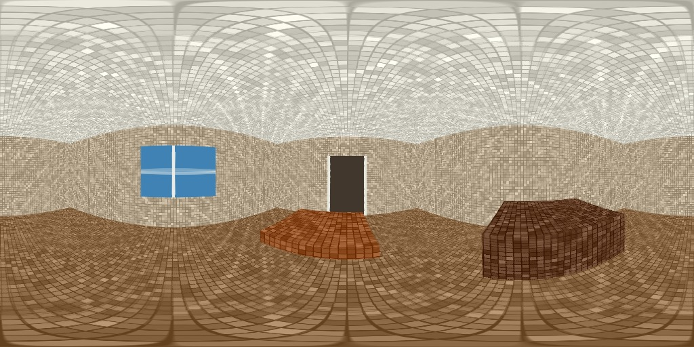
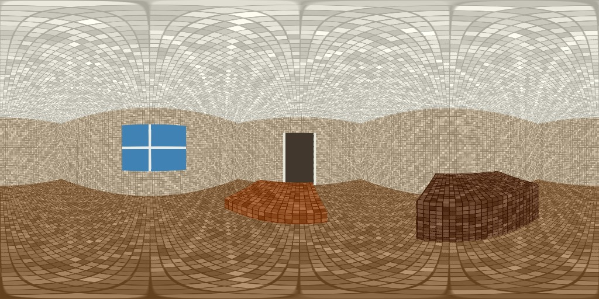

# Roll guidance and projection streak investigation

2026-11-19. Experimental capture build only. Owner Fold 7 approval is required before merging. No production website or agency data changes.

## Findings supported by the available originals

The available real source set is the earlier 25-photo ZIP, not a verified export of the latest reported failed experiment. All 25 individual JPEGs were inspected in a private contact sheet, with representative originals inspected at full resolution. The sweeping cross-band pattern reproduced below was not apparent in those source photos. This does not establish what is present in a newer capture/output that has not been supplied.

Saved target and full-axis pose replay exposes a real guidance defect:

| Saved target | Aim error | Roll error | Old stable gate | New gate |
|---|---:|---:|---|---|
| Ceiling, target-23 | 0.20 degrees | -66.48 degrees | Captures | Blocks |
| Floor, target-24 | 0.14 degrees | +56.48 degrees | Captures | Blocks |

The old gate measured stability of more than one axis, but **alignment only used forward direction**. A steadily rolled phone therefore passed. Known roll can be projected correctly, so this does not prove these two photographs caused all ghosting. Consistent orientation nevertheless improves repeatability, overlap and user guidance.

The available source axes are finite, orthonormal and consistently handed. No reflected-pose defect was found in this set. The previous FOV investigation remains applicable: 65 degrees is an unverified prior, and a source-based fit is confounded by sensor error, repeated texture, distortion and parallax. No phone-specific FOV was adopted.

## Full orientation guidance

The new indicator overlays two reference bars on the actual contained camera image. It gives left/right rotation instructions; green bars indicate roll alignment, while the target circle separately indicates aiming. Automatic capture requires all of:

- Aim within 4 degrees and inside the target circle.
- Roll within 8 degrees.
- Full relative rotation within 9 degrees, using all three camera axes.
- The existing fresh-sample, motion, dwell, duplicate and save-lock checks.

These are provisional tolerances tested by deterministic regression, **not physically validated tolerances**. Full rotation uses the relative orientation matrix, not a single Euler angle. At ceiling/floor targets the planned camera axes define reference bars; gravity alone cannot define roll while looking straight up/down. At large aim errors, guidance asks the user to aim first instead of presenting an unreliable level cue.

Portrait, landscape, inverted screen transforms and resumed sessions are covered by vector and browser tests. Existing rotation/background/camera recovery is retained. Stale or unavailable tracking does not display a successful level indication. Completed photos remain completed unless explicitly retaken. Existing photos are not retroactively rotated or deleted.

New captures save a snapshot of the raw orientation reading, heading, screen angle, video dimensions, reading age and full-orientation errors **before JPEG encoding**, enabling future frame/sensor-axis audits. This metadata stays local and in the explicit source ZIP. Tests do not certify how every physical browser rotates its camera frames; multi-device optical verification remains required.

Synthetic/fake-camera screenshots:

## Separate projection defect: radial foldover

The earlier experimental model applied `x_distorted = x * (1 + k1 * r_squared)` to every forward ray. With a negative coefficient this polynomial eventually turns around and maps distant rays back into the image. For example, with `k1 = -0.12`, a ray **70.89 degrees from the camera centre** maps to the centre pixel of a photo nominally 65 degrees wide. This is unrelated to ordinary feather-blending ghosting.

The renderer now:

- Uses a bounded, one-to-one forward/inverse lens model shared with alignment.
- Restricts projection to the valid monotonic branch and the inverse image-corner domain.
- Rejects lens models that cannot invert the complete image safely.
- Clamps both bilinear neighbours at every border and rejects non-finite pixels.
- Rejects reflected source axes and invalid exposure gains.

Automatic radial fitting is disabled: no independent distortion calibration justifies estimating that coefficient from these handheld matches. A bounded interpolation improves focal estimation between the old coarse candidates. Existing explicit negative coefficients can be analysed through the guarded model, but cannot reintroduce the remote folded branch.

Fault reproduction using the **same 25 real originals**, deliberately setting `k1 = -0.12` in both renderers:

- Before: 618,728 invalid source-to-output contributions; 337,755 distinct affected pixels out of 524,288.
- After: zero invalid contributions.
- All 25 source JPEG hashes remain unchanged. No photo was dropped.

This is an injected, reproducible failure case, **not proof that the newest phone output used a negative coefficient**. Actual real-source images and the comparison HTML remain private under the operator's local evidence folder; none were committed or uploaded.

The following publicly committed comparison uses only the procedural synthetic room and the same injected fault:

## Ordinary ghosting and acceptance guards

Removing the invalid branch is not a complete stitching solution. Sensor/FOV errors, camera translation, moving objects and feather blending can still duplicate geometry. The normal 25-photo baseline is pixel-identical before/after the projection refactor when no radial correction is requested. Its bad overlap is now rejected instead of being offered as a usable panorama.

New candidate acceptance requires:

- Every source photograph participates; no automatic unmatched-photo exclusion.
- A connected match graph, with explicit unmatched IDs on failure.
- Separate fitting, parameter-tuning and held-out correspondence subsets.
- Held-out symmetric reprojection RMS at most 3 pixels and 90th percentile at most 6 pixels in the feature images (long edge at most 800 pixels), with no invalid projections.
- Existing angular-residual limits and complete output coverage.
- A conservative sampled colour-disagreement guard.
- Explicit human inspection and approval.

The correspondence subsets come from the same matched/RANSAC-filtered photographs; they are not independent photographic ground truth. The colour guard samples 256x128 locations, rejects fewer than 128 useful overlap samples, more than 25% with pairwise RGB RMS above 40/255, or a 90th percentile above 85/255. These device-independent engineering thresholds can reject exposure/movement differences and can miss geometric defects. They do not certify photographic quality.

The available real set has 30.72% high-disagreement overlap samples and is rejected in the normal baseline path. Both old and new OpenCV matchers connect only 14/25 photographs; no valid complete real-room after-image is claimed. Textureless/repetitive ceiling and floor views may fail the stricter matching requirements. More photographs are not a guaranteed cure; a mature camera/seam pipeline remains a possible next engineering step.

OpenCV is now the default candidate engine. The sensor-only engine remains available as a **diagnostic preview that cannot be accepted**. Legacy/unverified previews cannot be accepted either. A failed attempt labels a retained image as a previous preview, directly above it, so an old result is not mistaken for a new OpenCV output. All source photos remain saved for retry/export.

## Identical-input controlled comparison

Same 28 procedural indoor photographs, perturbed sensor poses and FOV metadata; 1024x512 JPEG at 92%. Compared against commit `5f0385f`, with the same source hashes before/after.

| OpenCV candidate metric | Before | After |
|---|---:|---:|
| Known-reference RGB MAE /255 | 16.90 | 10.71 |
| False-edge proxy | 20,594 | 16,881 |
| Matched angular RMS | 0.674 degrees, fitted data | 0.134 degrees, held-out subset |
| Held-out image RMS / p90 | Not enforced | 0.94 / 1.44 pixels |
| Automatic radial coefficient | +0.12 | Disabled / 0 |
| Focal tangent scale | 0.95 | 0.9082 |
| JPEG bytes | 206,621 | 217,774 |
| Desktop worker wall time in paired run | 38.838 s | 33.737 s |

The angular columns use different fitting/test subsets and are not a direct independent-accuracy comparison. The edge proxy is not a duplicate-object count. Timings vary with desktop load and are not phone CPU measurements. Main allocation estimate at 1024x512 rises from about 40.0 MB to 40.8 MB; neither estimate includes peak browser/GPU/WASM memory. The previously observed 128 MiB WASM heap capacity is not peak process memory.

No synthetic result establishes Fold 7 photographic acceptance.

## Worker policy and Cloud emulator verification

OpenCV in this pinned build generates JavaScript bindings at runtime. The prior isolated HTTPS stitch-worker response had **no CSP**, even though the parent document had one. Workers do not acquire that document policy automatically. The revision applies an explicit policy only to the stitching worker: trusted same-origin script imports and binding/WASM execution are allowed, network connections are denied, and nested workers are denied. Parent and production staff-document policies are not relaxed.

`capture/security-headers.mjs` defines the isolated worker policy; the loopback server and capture-only Cloud emulator share it. Isolated HTTPS staging must apply its header block to `/capture/stitch-worker.js`. The capture service-worker version includes the policy so cached workers refresh with the headers. No production capture or policy change is activated.

A browser probe verifies both required execution modes and verifies same-origin/external fetches are blocked **before reaching the network**. It uses no photos or credentials. CI also found that the existing Cloud capture emulator did not serve the nested OpenCV vendor bundle; fixed that test-only allowlist and scoped policy, then verified one qualified JPEG upload after approval, exact private revision persistence and anonymous denial against in-memory D1/KV. No live Cloud data is involved.

## Reproduce and remaining physical gate

- `npm test`: full regression suite, including full-axis gating, poles, transforms, monotonic projection, inverse roundtrips, borders and quality-contract rejection.
- `node capture/roll-browser-test.mjs`: fake camera/sensors, steady wrong roll, correct capture, retake, pole references, landscape resume, metadata snapshot and saved frames.
- `node capture/worker-policy-browser-test.mjs`: worker binding/WASM execution and network-denial probe.
- Existing recovery/calibration/guidance/browser scripts: complete capture mechanics, permission failures, restart/offline, qualified candidate-to-editor and backup byte parity. Fake-camera sweeps explicitly permit safe rejection and never call fake images approved photographic output.
- `node capture/streak-test.mjs`: paired old/current local comparison; requires the before commit in local Git history. `CAPTURE_STREAK_CONTROLLED=1` selects the same perturbed 28-photo fixture. `CAPTURE_STREAK_PROJECTION_ONLY=1` skips expensive feature fitting.
- Optional private `STITCH_SOURCE` adapter: real source data is passed locally to the loopback browser, never served/uploaded. Real-image output is refused inside the repository.

Physical checklist: refresh the isolated test site without clearing browser storage; start a new capture; perform Camera setup; deliberately roll at a wall and confirm capture pauses; level the bars and capture; repeat looking up/down; rotate screen, resume/realign, and select an unfinished dot; complete a static test room rotating around the lens; inspect the OpenCV candidate and save original sources. Confirm retakes, refresh recovery and all completed photos. Repeat on another device/browser before broad compatibility claims.

No attached Android device was available in ADB. Latest problematic source ZIP plus its output JPEG are still needed to verify that exact failure. Keep real data private. **Do not merge until owner confirms acceptable Fold 7 results.**
