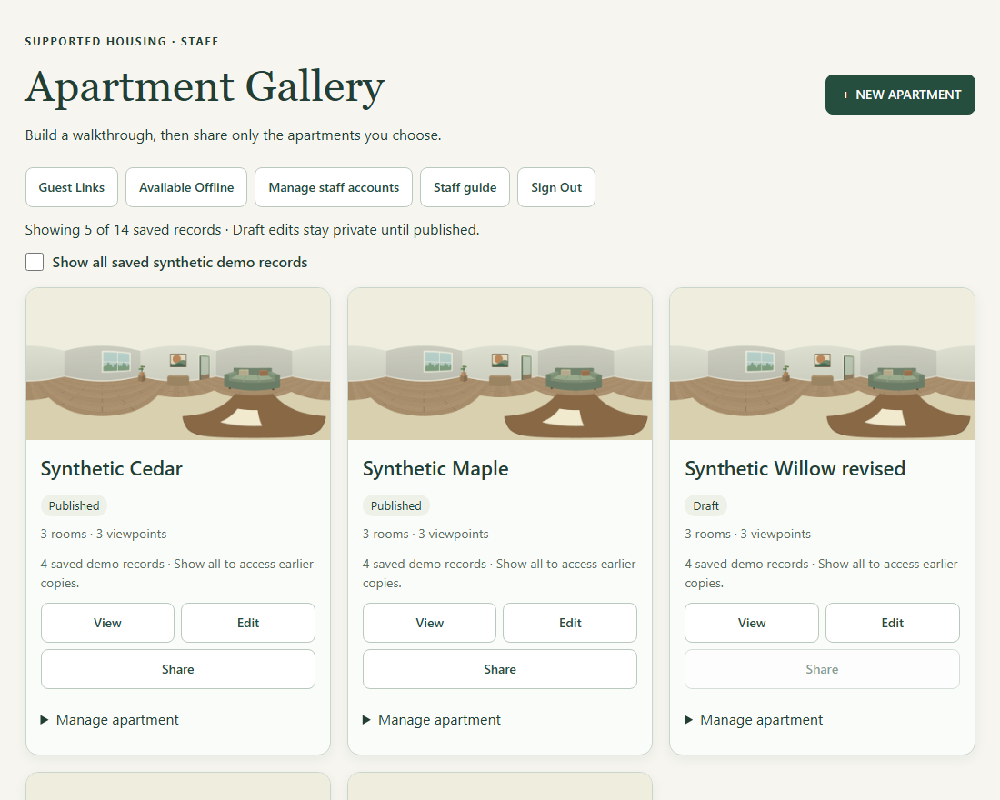
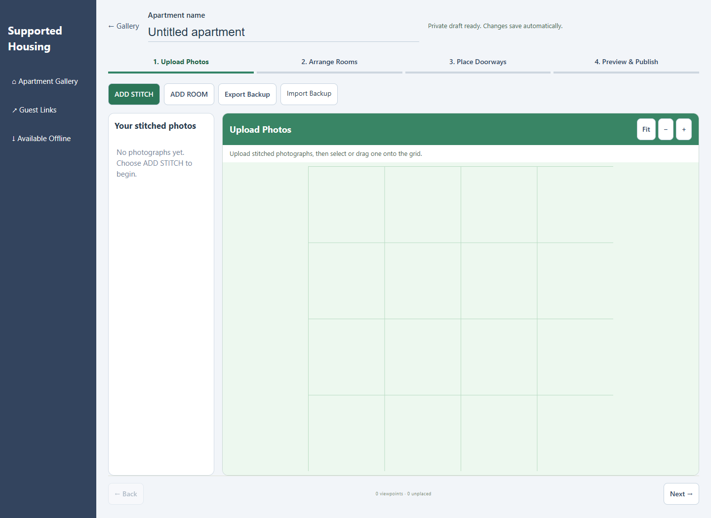
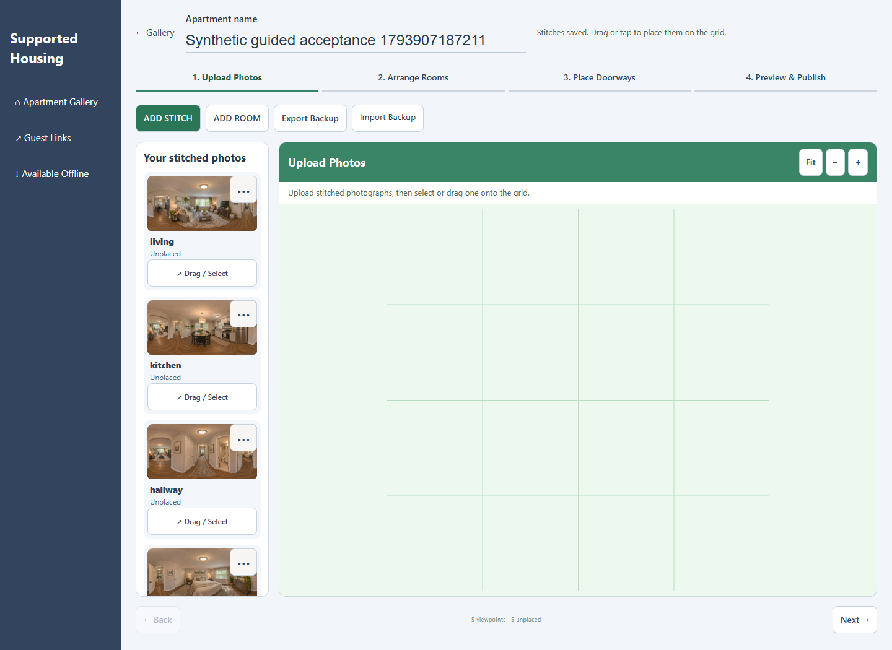
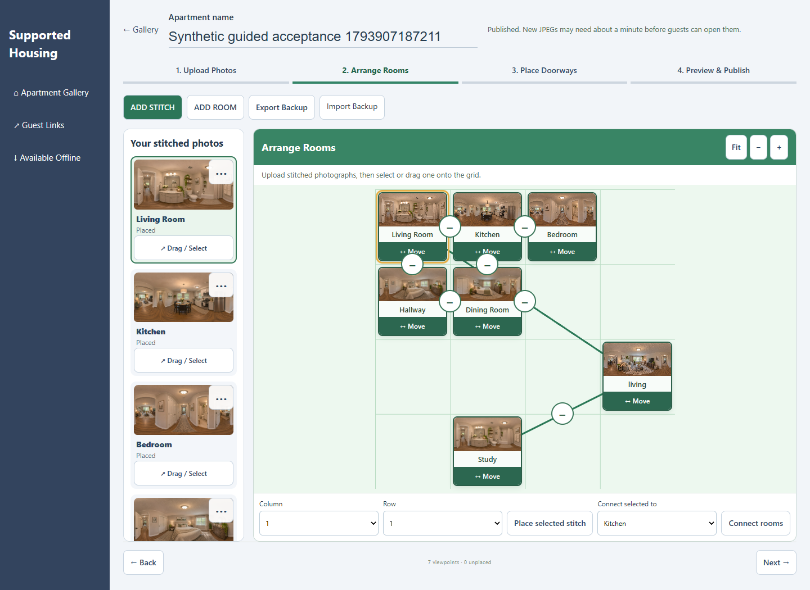
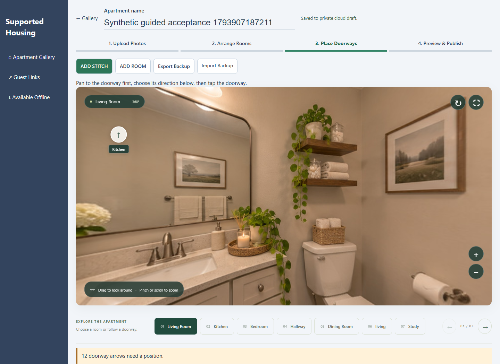
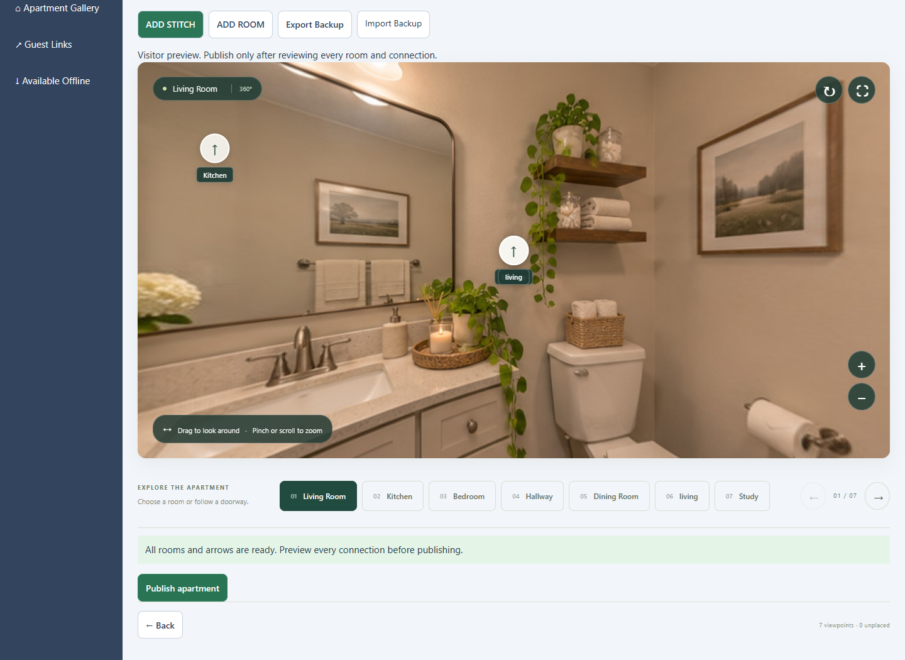
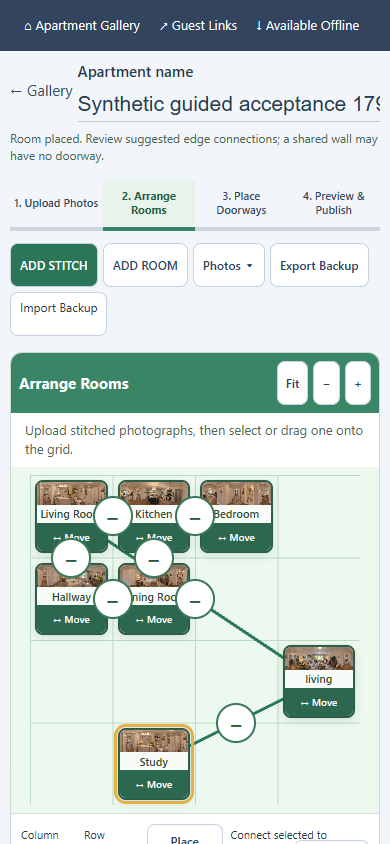
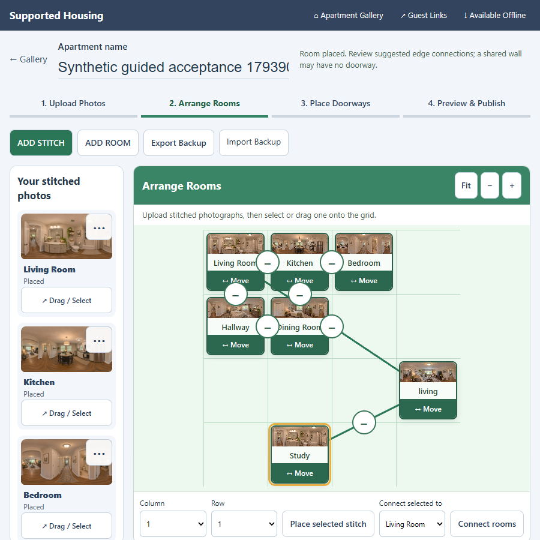

# Implemented guided editor

Actual screenshots of the synthetic Cloudflare application, 5 November 2026. The approved reference was inspected privately; it is not included here. Browser viewports are emulated, not physical-device certification. Test apartments and invitations were withdrawn after testing. Test arrow positions exercise pointer and keyboard saving; staff must choose actual doorways in real tours.

## Apartment Gallery

Three grouped synthetic demo families; all saved records remain accessible. Two older private Willow drafts are also retained below this view.

## New Apartment — empty cloud draft

## Upload Photos — all stitches remain in the filmstrip

## Arrange Rooms — grid, inline names and connectors

## Place Doorways — actual panorama and pending directions

## Preview & Publish

## Folded and unfolded layouts

Touch and keyboard movement were tested in independent Edge. Physical Fold dragging, pinch/pan, fullscreen, installation and airplane-mode restart remain in [PILOT.md](../PILOT.md).

